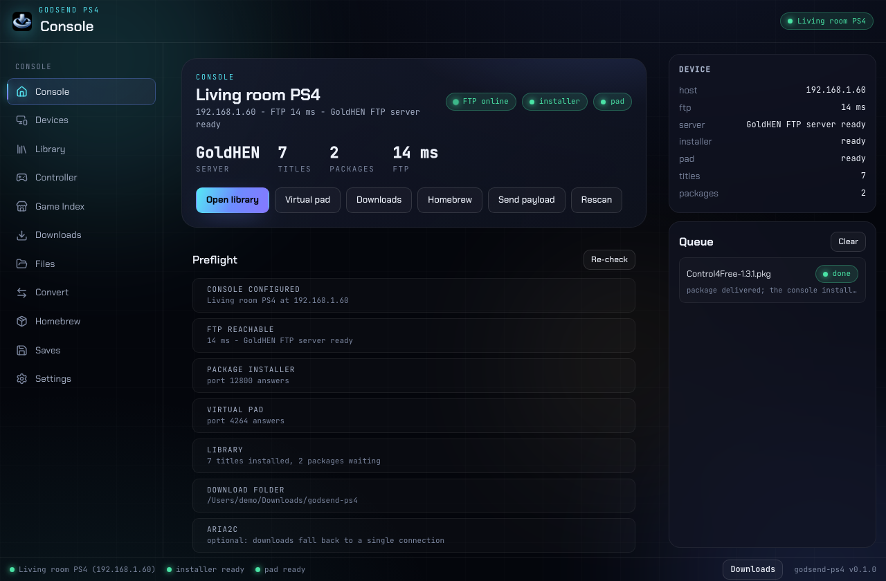
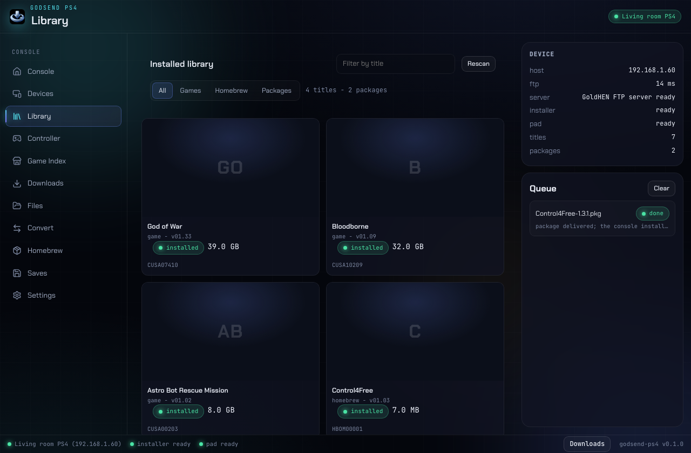

# GODsend PS4

[](https://ghostyshell.github.io/godsend-ps4/)
[](https://discord.gg/d3sFnrgpJn)
[](https://ko-fi.com/ghosty99)
[](https://etherscan.io/address/0xbBef115aD853236a350EaF04777a2AdB2e7c0317)

A desktop workshop for a jailbroken PS4 running GoldHEN. It talks to the
console over FTP, streams packages straight into its installer, drives a
virtual DualShock 4, and keeps the whole library in one window. Same family
look and feel as GODsend PSP, GODsend PS3 and GODsend 360, built on the same
Rust engine + Tauri 2 + React stack.

| Console | Library |
| --- | --- |
|  |  |

One short guide per feature lives in [docs/guides](docs/guides/index.md).

## What it does

- **Devices**: add consoles by address, scan the LAN for FTP servers on 2121
  and 21, and see FTP latency, the FTP banner, the package installer, the pad
  service and a title count. Multiple consoles, one active.
- **Library**: reads `/user/appmeta` on the console, so the grid shows what is
  actually installed with its icon, title id, version and storage location.
  Patches and DLC are filtered out of the grid, packages waiting in
  `/user/pkg` are listed separately, USB titles show up under `external`.
- **Virtual controller**: a DualShock 4 rendered in the app, sent to the
  console over WebRTC. Buttons, triggers, both sticks, PS, share, options and
  the touchpad click; keyboard mapping for everything. It talks to the
  Control4Free payload, which installs from the Homebrew page like any other
  package.
- **Package installs**: GoldHEN's remote installer (port 12800) takes a URL,
  not an upload, so the app serves the file on a one-shot HTTP listener bound
  to the interface that reaches the console and lets it pull. A 40 GB
  package never lands on the internal drive twice. With no installer around it
  falls back to `/user/pkg`.
- **Payloads**: send a `.bin` / `.elf` over the bin loader (port 9090) from
  the Console page or the CLI.
- **Files**: browse and edit both sides, upload and download whole trees, and
  split anything above the FAT32 limit on the way to a USB drive.
- **Convert**: unpack a PKG to a folder (PFS decryption included), split a
  package for FAT32, merge a split set.
- **Saves**: list `/user/home/<user>/savedata`, zip selected folders to
  Downloads, restore them, delete with a confirmation.
- **Downloads and store**: search the game index or Internet Archive, resolve
  a link through Real-Debrid or TorBox when keys are set, download with aria2,
  then install the result.
- **No drivers**: FTP, HTTP and WebRTC over the LAN. Nothing to plug in.

## Requirements

- A PS4 running **GoldHEN** (or any payload that provides FTP on 2121, the
  remote package installer on 12800 and a bin loader on 9090).
- For the virtual controller, **Control4Free** installed on the console
  (Homebrew page, or its own PKG).
- macOS 12+, Windows 10+ or a Linux desktop with WebKitGTK 4.1.
- `aria2c` on PATH is optional; without it downloads use a single connection.

## Download

<!-- downloads:start -->
| Build | GoFile (primary) | file.kiwi (backup) | Size |
| --- | --- | --- | --- |
| `godsend-ps4-0.1.0-linux-x64.AppImage` | [Download](https://gofile.io/d/qI3SqQtM) | [Mirror](https://file.kiwi/c3dd9d21#n89A_aRW97UKK3b3ANZTtA) | 80.9 MiB |
| `godsend-ps4-cli-0.1.0-linux-x64.tar.gz` | [Download](https://gofile.io/d/e3CT6kTm) | [Mirror](https://file.kiwi/cc489133#oE4aeRwfRPtJ2vi6UbiFPg) | 4.4 MiB |
| `godsend-ps4-cli-0.1.0-macos-arm64.tar.gz` | [Download](https://gofile.io/d/MAOQhguW) | [Mirror](https://file.kiwi/410d3c6f#eR7EWJvW5AsF9UExuZH_IQ) | 4.0 MiB |
| `godsend-ps4-cli-0.1.0-macos-x64.tar.gz` | [Download](https://gofile.io/d/LwGcduLn) | [Mirror](https://file.kiwi/3189fbdd#E66qEiCDf8AuQRT8VusvGQ) | 4.3 MiB |
| `godsend-ps4-cli-0.1.0-windows-x64.zip` | [Download](https://gofile.io/d/LYSy5pEp) | [Mirror](https://file.kiwi/13262d43#N-iwtjGRwhNOPXhVXF-8Qw) | 4.4 MiB |
| `godsend-ps4-0.1.0-linux-x64.deb` | [Download](https://gofile.io/d/xCRvJDSP) | [Mirror](https://file.kiwi/077f36cd#SjB_dyyRlEHjygXlmEPk3A) | 6.1 MiB |
| `godsend-ps4-0.1.0-arm64.dmg` | [Download](https://gofile.io/d/Ntsq8AtL) | [Mirror](https://file.kiwi/e3579259#85jAjz2xgRI73a2syi3eug) | 6.3 MiB |
| `godsend-ps4-0.1.0-x64.dmg` | [Download](https://gofile.io/d/kVu8Nabo) | [Mirror](https://file.kiwi/df41c20f#VQHxJTNeasNtsUt5mP6qvw) | 6.8 MiB |
| `godsend-ps4-0.1.0-x64-setup.exe` | [Download](https://gofile.io/d/uhHTMf4f) | [Mirror](https://file.kiwi/181e0f75#o8v3PmGbeGVdqzqukCKG6Q) | 4.3 MiB |
<!-- downloads:end -->

Mirrors follow the sibling projects: **GoFile** is the primary host and
**file.kiwi** is the encrypted backup. Links are refreshed weekly because
GoFile expires free-tier files. Until the first upload lands, build from
source with the steps below.

## Guides

1. [Connect your PS4](docs/guides/connect-your-ps4.md)
2. [Install a game or homebrew](docs/guides/installing-games.md)
3. [The virtual controller](docs/guides/controller.md)
4. [Saves](docs/guides/saves.md)
5. [Conversions](docs/guides/conversions.md)
6. [Troubleshooting](docs/guides/troubleshooting.md)

## Build from source

```sh
cargo build --release -p godsend-ps4-cli   # CLI
cargo test --workspace                     # engine and mock-console tests
npm --prefix app install
npm --prefix app run build                 # type check plus vite build
npm --prefix app run tauri build           # desktop app
npm --prefix app run dev:mock              # browser UI with fixtures
```

The CLI shares the engine with the app. `godsend-ps4 help` lists every
command; `godsend-ps4 status`, `scan`, `install`, `saves`, `backup`, `extract`
and `split` cover the daily ones.

## How it works

- **FTP** (`core/src/ftp.rs`): `suppaftp`, tolerant listings (MLSD, Unix
  LIST, DOS LIST), progress and cancellation, plus a head read used to pull
  `param.json` and icons without fetching whole files.
- **Remote install** (`core/src/rpi.rs`): a one-shot HTTP server, a
  `POST /api/install` with the file's URL, a resume-aware `GET`, and a
  cancellable accept loop.
- **Virtual pad** (`core/src/pad.rs` plus `app/src/pages/Controller.tsx`): the
  native side posts the WebRTC offer, because the payload refuses a foreign
  `Origin` and a webview always sends one. The webview owns DTLS/SCTP and
  streams the input message at 60 Hz.
- **Library** (`core/src/library.rs`): `param.json` parsing with fallbacks for
  every GoldHEN build, icons cached by path hash.
- **PKG** (`core/src/pkg.rs`): header scan for remote files, and
  `orbis-pkg-util` for local extraction.

## Licence

MIT. Not affiliated with Sony. Use it on consoles you own.
